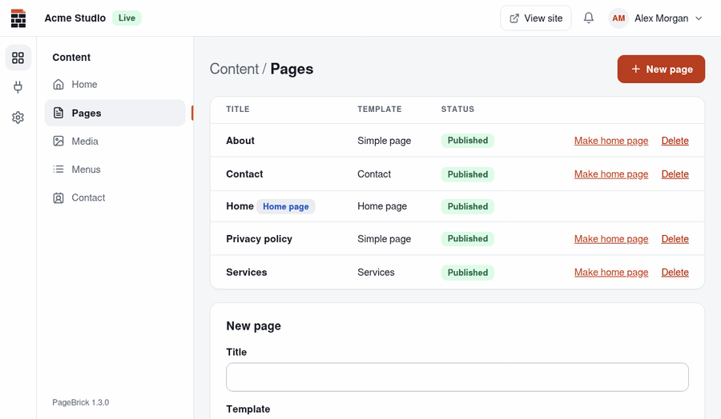
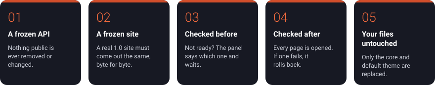

<p align="center"><picture><source media="(prefers-color-scheme: dark)" srcset="docs/brand/svg/pagebrick-logo-horizontal-negativo.svg"></picture></p>

<p align="center"><b>English</b> · <a href="README.pt-BR.md">Português</a> · <a href="README.es.md">Español</a></p>

<p align="center">
<a href="https://github.com/PageBrick/pagebrick/releases/latest"></a>
<a href="https://github.com/PageBrick/pagebrick/actions/workflows/tests.yml"></a>
<a href="LICENSE"></a>

</p>

<p align="center"></p>

A simple, open-source CMS for any kind of website: a personal page, a project, a club, a shop or a business. Anyone can install it, without technical knowledge, and publish a site with a ready-made layout; developers build their own themes on an organized structure, with complete freedom on the front end and the guarantee that updates won't break the sites they deliver.

## Five pillars: updates that don't break sites

Clicking **Update** must never break a site someone built. Every promise below is checked by automated tests on each release ([how it is enforced](docs/en/compatibility.md)).

<p align="center"></p>

| | Pillar | The promise |
|---|---|---|
| 1 | **A frozen API** | Everything themes and plugins use is listed and versioned. Within a version, nothing is removed or changed. |
| 2 | **A frozen site** | A real site built on 1.0 must deliver the same HTML, byte for byte, on every new release. |
| 3 | **Checked before** | If an active plugin or the theme isn't ready for the new version, the panel says which one and waits. |
| 4 | **Checked after** | The first visit after an update renders every page. If one fails, the previous version comes back on its own. |
| 5 | **Your files untouched** | Updates replace the core and PageBrick's own default theme. Your themes, plugins, photos and settings stay exactly as they are. |

## What it does

- Step-by-step installer (language, server check, database, site) that creates a finished example site: Home, About, Services, Contact and Privacy policy, with photos. In Portuguese, English or Spanish.
- Pages with fields, sections editors can hide, history with "restore", drafts and preview.
- Logo, color and font style under **Settings → Appearance** (administrators); WhatsApp, contact details and social links under **Contact**.
- Themes you can switch without losing content, with a private preview before activating.
- Contact form (messages in the panel and by e-mail, spam protection without captcha) and a blog with categories, as official plugins.
- Plugin and theme store with signed packages, .zip upload, updates with backup, "roll back" and automatic undo if a new version breaks.
- Circuit breakers: a broken plugin or theme is switched off on its own and the site stays up. Safe mode with a rescue link.
- One-click updates of PageBrick itself that check the whole site afterwards and go back on their own if anything broke.
- Sites in more than one language: the main one at the root, others under /pt-br, /es-es or /en-us, with translated pages, menus and texts.
- A discreet bar on the site for people signed in to the panel: the way back, quick actions and a live view that reloads the page when something is saved.
- A clean panel with a side menu that is light, dark or the system's (the default), chosen by each person in their account menu.
- Content API (JSON) for front ends built with Next.js, Astro or any other framework.
- "Under construction" and "Maintenance" switches: visitors see a notice, people logged in see the site.
- SEO basics (title and description per page, friendly addresses, sitemap.xml, robots.txt), images resized to WebP, no cookies for visitors.
- Two roles: Administrator (installs, themes, plugins and settings) and Editor (writes the content).

## Requirements

PHP 8.2+ with `pdo_mysql` and `gd`, MySQL 5.7+ or MariaDB 10.4+, and Apache with `mod_rewrite`: any cPanel hosting.

## Installing

1. Download `pagebrick-x.y.z.zip` from [Releases](https://github.com/pagebrick/pagebrick/releases) and upload the contents of its `pagebrick/` folder to your hosting.
2. Create a MySQL database (in cPanel: "MySQL Databases").
3. Open the site's address and fill in the installer.

## For developers

- [Building a theme](docs/en/themes.md): the front end is entirely yours.
- [Building a plugin](docs/en/plugins.md)
- [Content API (headless)](docs/en/headless.md): the content as JSON, for front ends built outside PageBrick.
- [The compatibility promise](docs/en/compatibility.md): why updates don't break your sites.
- [Publishing: catalog, signatures and releases](docs/en/publishing.md)

### Local development

```bash
docker compose up -d --build
docker compose exec app composer install
```

Open http://localhost:8080. In the installer use server `db`, database `pagebrick`, user `pagebrick` and password `pagebrick`.

Test accounts used in local development: `admin@pagebrick.test` (administrator) and `editor@pagebrick.test` (editor), both with the password `pagebrick-local`.

E-mails sent by the local site are caught by Mailpit at http://localhost:8025. To use it, set server `mailpit`, port `1025` and security "None" under **Settings → Email**.

Tests:

```bash
docker compose exec app vendor/bin/phpunit
```

To start over: delete `config.php` and run `docker compose down -v`.

## License

[MIT](LICENSE). Created by [Alcateia Digital](https://alcateia.digital). Includes the [TipTap](https://tiptap.dev) and [ProseMirror](https://prosemirror.net) editor (MIT), [PHPMailer](https://github.com/PHPMailer/PHPMailer) (LGPL 2.1), the Public Sans, Fraunces and Nunito fonts (OFL) and public-domain example photos (CC0).
