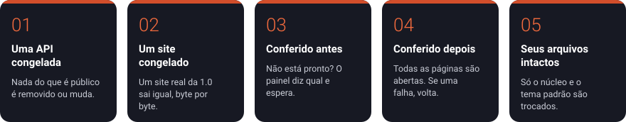

<p align="center"><picture><source media="(prefers-color-scheme: dark)" srcset="docs/brand/svg/pagebrick-logo-horizontal-negativo.svg"></picture></p>

<p align="center"><a href="README.md">English</a> · <b>Português</b> · <a href="README.es.md">Español</a></p>

<p align="center">
<a href="https://github.com/PageBrick/pagebrick/releases/latest"></a>
<a href="https://github.com/PageBrick/pagebrick/actions/workflows/tests.yml"></a>
<a href="LICENSE"></a>

</p>

<p align="center"></p>

Um CMS simples e de código aberto para qualquer tipo de site: uma página pessoal, um projeto, um clube, uma loja ou uma empresa. Qualquer pessoa instala, sem conhecimento técnico, e publica o site com um layout pronto; quem desenvolve cria os próprios temas sobre uma estrutura organizada, com liberdade total no front-end e a garantia de que as atualizações não vão quebrar os sites entregues.

## Cinco pilares: atualizações que não quebram o site

Clicar em **Atualizar** nunca pode quebrar um site que alguém construiu. Cada promessa abaixo é conferida por testes automáticos a cada versão ([como é garantido](docs/pt-BR/compatibilidade.md)).

<p align="center"></p>

| | Pilar | A promessa |
|---|---|---|
| 1 | **Uma API congelada** | Tudo o que temas e plugins usam está listado e tem versão. Dentro de uma versão, nada é removido nem muda. |
| 2 | **Um site congelado** | Um site real feito na 1.0 precisa entregar o mesmo HTML, byte por byte, em toda versão nova. |
| 3 | **Conferido antes** | Se um plugin ativo ou o tema não estiver pronto para a versão nova, o painel diz qual e espera. |
| 4 | **Conferido depois** | A primeira visita depois da atualização abre todas as páginas. Se uma falhar, a versão anterior volta sozinha. |
| 5 | **Seus arquivos intactos** | A atualização troca o núcleo e o tema padrão do próprio PageBrick. Os seus temas, plugins, fotos e configurações ficam exatamente como estão. |

## O que ele faz

- Instalador em etapas (idioma, conferência do servidor, banco de dados, site) que cria um site de exemplo pronto: Início, Sobre, Serviços, Contato e Política de privacidade, com fotos. Em português, inglês ou espanhol.
- Páginas com campos, seções que quem edita pode esconder, histórico com "restaurar", rascunhos e pré-visualização.
- Logo, cor e estilo de letra em **Configurações → Aparência** (administradores); WhatsApp, dados de contato e redes sociais em **Contato**.
- Temas que você troca sem perder conteúdo, com pré-visualização privada antes de ativar.
- Formulário de contato (mensagens no painel e por e-mail, proteção contra spam sem captcha) e blog com categorias, como plugins oficiais.
- Loja de plugins e temas com pacotes assinados, envio de .zip, atualizações com backup, "voltar versão" e desfazer automático se uma versão nova quebrar.
- Disjuntores: um plugin ou tema quebrado é desligado sozinho e o site continua no ar. Modo de segurança com link de socorro.
- Atualizações do próprio PageBrick em um clique, que conferem o site inteiro depois e voltam sozinhas se algo quebrou.
- Sites em mais de um idioma: o principal na raiz e os outros em /pt-br, /es-es ou /en-us, com páginas, menus e textos traduzidos.
- Uma barra discreta no site para quem está logado no painel: o caminho de volta, ações rápidas e uma visão ao vivo que recarrega a página quando algo é salvo.
- Painel limpo, com menu lateral, claro, escuro ou o do sistema (o padrão), escolhido por cada pessoa no menu da conta.
- API de conteúdo (JSON) para front-ends feitos com Next.js, Astro ou qualquer outro framework.
- Chaves de "Em construção" e "Em manutenção": visitantes veem um aviso, quem está logado vê o site.
- SEO básico (título e descrição por página, endereços amigáveis, sitemap.xml, robots.txt), imagens redimensionadas para WebP, nenhum cookie para os visitantes (a não ser que o dono ligue o Google Analytics ou o pixel da Meta, e então só depois de o visitante aceitar).
- Dois papéis: Administrador (instala, temas, plugins e configurações) e Editor (escreve o conteúdo).

## Requisitos

PHP 8.2+ com `pdo_mysql` e `gd`, MySQL 5.7+ ou MariaDB 10.4+ e Apache com `mod_rewrite`: qualquer hospedagem com cPanel.

## Instalação

1. Baixe o `pagebrick-x.y.z.zip` em [Releases](https://github.com/pagebrick/pagebrick/releases) e envie o conteúdo da pasta `pagebrick/` dele para a sua hospedagem.
2. Crie um banco de dados MySQL (no cPanel: "Bancos de dados MySQL").
3. Abra o endereço do site e preencha o instalador.

## Para desenvolvedores

- [Criando um tema](docs/pt-BR/temas.md): o front-end é todo seu.
- [Criando um plugin](docs/pt-BR/plugins.md)
- [API de conteúdo (headless)](docs/pt-BR/headless.md): o conteúdo em JSON, para front-ends feitos fora do PageBrick.
- [A promessa de compatibilidade](docs/pt-BR/compatibilidade.md): por que as atualizações não quebram os seus sites.
- [Publicação: catálogo, assinaturas e versões](docs/pt-BR/publicacao.md)

### Desenvolvimento local

```bash
docker compose up -d --build
docker compose exec app composer install
```

Abra http://localhost:8080. No instalador, use o servidor `db`, o banco de dados `pagebrick`, o usuário `pagebrick` e a senha `pagebrick`.

Contas de teste usadas no desenvolvimento local: `admin@pagebrick.test` (administrador) e `editor@pagebrick.test` (editor), as duas com a senha `pagebrick-local`.

Os e-mails enviados pelo site local são capturados pelo Mailpit em http://localhost:8025. Para usá-lo, configure o servidor `mailpit`, a porta `1025` e a segurança "Nenhuma" em **Configurações → E-mail**.

Testes:

```bash
docker compose exec app vendor/bin/phpunit
```

Para começar do zero: apague o `config.php` e rode `docker compose down -v`.

## Licença

[MIT](LICENSE). Criado pela [Alcateia Digital](https://alcateia.digital). Inclui o editor [TipTap](https://tiptap.dev) e o [ProseMirror](https://prosemirror.net) (MIT), o [PHPMailer](https://github.com/PHPMailer/PHPMailer) (LGPL 2.1), as fontes Public Sans, Fraunces e Nunito (OFL) e fotos de exemplo em domínio público (CC0).
